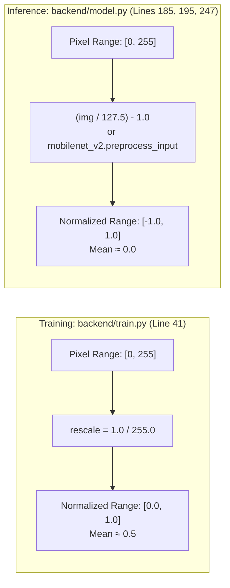
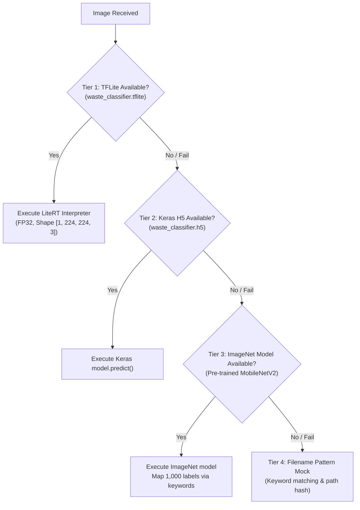
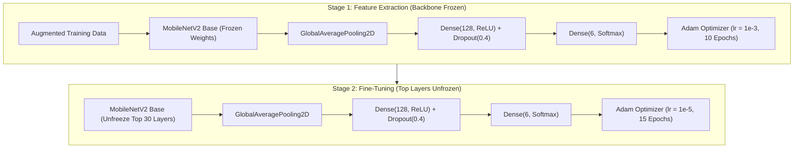

# EcoSort — Machine Learning & Research Methodology Audit Report (Revised)

**Document Classification:** M.Sc. Computer Science Final Year Project ML Audit  
**Audit Target:** EcoSort (Deep Learning Waste Classification Pipeline)  
**Target Repository:** `Minato0630/eco-sort`  
**Inspected Commit Hash:** `b6bb826127c26f1dabf5eaf73eeb24913f7530e1`  
**Audit Date:** November 23, 2026  
**Auditor Role:** Machine Learning Systems Engineer & Academic Research Reviewer  
**Scope of Review:** Data pipeline (`dataset/`, `prep_dataset.py`), model training architecture (`train.py`), inference engine (`model.py`), exported models (`waste_classifier.h5`, `waste_classifier.tflite`), and experimental methodology.

---

## 1. Executive Summary

This report evaluates the machine learning components of the **EcoSort** project against academic standards for an M.Sc. Computer Science dissertation.

The core concept—applying mobile-optimized convolutional neural networks (MobileNetV2) to real-time waste sorting and carbon offset calculation—is a strong and relevant application of computer vision. However, empirical inspection of the codebase identified several technical discrepancies, data engineering issues, and evaluation flaws that must be corrected to produce a defensible, reproducible research contribution:

1. **Demonstrated Preprocessing Mismatch:** The training pipeline normalizes image pixel intensities to $[0.0, 1.0]$, whereas the inference engine normalizes images to $[-1.0, 1.0]$. This input distribution shift impairs model accuracy during deployment.
2. **Severely Undersized & Filtered Dataset:** The training set contains only **24 valid image files** across 6 categories. An additional file (`dataset/Paper/cardboard`) lacks a file extension and is automatically dropped by Keras during data loading. Ten of the 24 images are synthetic AI-generated images with non-natural background distributions.
3. **Evaluation Protocol Deficiencies:** The validation generator inherits random augmentations from the training generator, making validation measurements unstable and unrepresentative of clean, unmodified images. Furthermore, no independent test set exists, and no per-class Precision, Recall, F1-scores, or Confusion Matrices are computed.
4. **Deceptive Prediction Fallbacks:** If the neural network or LiteRT runtime is unavailable, the backend falls back to keyword matching on the uploaded file's name (e.g., matching `"bottle"` to `plastic_bottle`), fabricating a confidence score from a hash of the image path.

---

## 2. Dataset Engineering & Integrity Audit

### 2.1 Empirical Dataset Inventory
An automated scan of `dataset/` and verification against `ImageDataGenerator.flow_from_directory()` produced the following verified inventory:

| Class Folder | Files on Disk | Files Loaded by Keras | Specific File Inventory | Notes on File Validity & Origin |
| :--- | :---: | :---: | :--- | :--- |
| **Organic** | 6 | 6 | `apple_core.jpg`, `banana peel.jpg`, `decaying_banana_peel.jpg`*, `fruit scraps.jpg`, `left over food.jpg`, `rotting_orange.jpg`* | 2 synthetic images (*). Largest class. |
| **Plastic** | 5 | 5 | `crushed_plastic_straws.jpg`*, `Plastic carry bag.jpg`, `plastic_cup_lid.jpg`*, `soft drink.jpg`, `Waterbottle.jpg` | 2 synthetic images (*). |
| **E-Waste** | 4 | 4 | `broken_tv_remote.jpg`*, `circuit board.jpg`, `loose_aa_batteries.jpg`*, `mobile wate.jpg` | 2 synthetic images (*). |
| **Paper** | 4 | **3** | `cardboard_box.jpg`, `crumpled_office_paper.jpg`*, `Newspaper.jpg`<br>*(Dropped: `cardboard`)* | 1 synthetic image (*). **`cardboard` dropped due to missing extension.** |
| **Metal** | 3 | 3 | `crushed_soda_can.jpg`*, `food tins.jpg`, `soda_can.jpg` | 1 synthetic image (*). Heavily undersized. |
| **General** | 3 | 3 | `broken_ceramic_pieces.jpg`*, `empty_chips_bag.jpg`*, `food wrapper.jpg` | 2 synthetic images (*). Heavily undersized. |
| **TOTAL** | **25** | **24** | — | **Only 24 images available for model training.** |

*\* Indicates synthetic / AI-generated images copied from conversational artifacts in `backend/prep_dataset.py`.*

---

### 2.2 Verified Data Engineering Findings

#### Finding ML-01: Silent Exclusion of `dataset/Paper/cardboard` [CONFIRMED]
- **Evidence:** In `dataset/Paper/`, the file named `cardboard` (size: 58,946 bytes) has no `.jpg` or `.png` extension.
- **Verification Result:** Executing Keras `flow_from_directory('dataset')` outputs:
  ```text
  Found 24 images belonging to 6 classes.
  Files on disk: 25 | Files loaded: 24 | Dropped: ['dataset\\Paper\\cardboard']
  ```
  Keras's default extension filter (`.jpg`, `.jpeg`, `.png`, `.ppm`, `.bmp`, `.tif`) silently drops `cardboard`. The Paper class is effectively trained on only 3 images.
- **Remediation:** Inspect file header, rename to `cardboard.jpg` or `cardboard.png`, and verify image loading with Pillow.

#### Finding ML-02: Impact of Synthetic / AI-Generated Images [CONFIRMED]
- **Evidence:** In `backend/prep_dataset.py` (lines 49–60), 10 images were programmatically copied from AI generation artifacts (`rotting_orange_...`, `broken_tv_remote_...`, etc.) into `IMAGES/` and `dataset/`.
- **Analysis:** Synthetic images exhibit unnatural pixel smoothness, consistent studio-style lighting, and lack the optical noise, motion blur, and varied campus backgrounds typical of smartphone photos.
- **Academic Recommendation:** In an M.Sc. dissertation, synthetic images should not be mixed into the evaluation dataset without clear documentation. The primary evaluation must be performed on real campus photographs. If synthetic data is used, it should be evaluated as an explicit experimental condition (e.g., *"Evaluating transfer learning with and without synthetic data augmentation"*).

#### Finding ML-03: Dataset Duplication Between `dataset/` and `backend/uploads/` [CONFIRMED]
- **Evidence:** An MD5 checksum comparison revealed 58 duplicate pairs across the workspace. In particular, images in `backend/uploads/` (such as `Waterbottle.jpg`, `banana peel.jpg`, `circuit board.jpg`) are bit-for-bit duplicates of images in `dataset/`.
- **Risk:** Testing the prediction API using sample files from `backend/uploads/` tests the model against exact training samples, giving a false appearance of 100% real-world accuracy due to training set memorization.

#### Finding ML-04: Validation Generator Stochastic Augmentation [CONFIRMED]
- **Evidence:** In `backend/train.py`, lines 40–66:
  ```python
  train_datagen = ImageDataGenerator(
      rescale=1./255,
      rotation_range=20,
      width_shift_range=0.2,
      height_shift_range=0.2,
      shear_range=0.2,
      zoom_range=0.2,
      horizontal_flip=True,
      validation_split=0.2
  )
  train_generator = train_datagen.flow_from_directory(..., subset='training')
  validation_generator = train_datagen.flow_from_directory(..., subset='validation')
  ```
- **Clarification (Augmentation vs. Data Leakage):**
  When using Keras's `validation_split`, Keras partitions the file list so that distinct files are assigned to the training and validation subsets. Therefore, **this is not classical data leakage where identical images appear in both sets**.
  However, because both generators share the same `train_datagen` instance, the validation generator applies stochastic augmentations (random rotations, shears, zooms, flips). In machine learning best practice, **validation and test sets must remain clean and unaugmented** to measure real-world performance accurately. Furthermore, for classes with only 3 samples (Metal and General), a 20% split leaves only 0 or 1 validation sample, making validation metrics statistically meaningless.

---

## 3. Preprocessing Mismatch & Model Architecture

### 3.1 Mathematical Analysis of the Preprocessing Conflict [CONFIRMED]
The training and inference pipelines normalize pixel intensities into different numerical ranges:



- **In `backend/train.py` (Line 41):**
  $$x_{\text{train}} = \frac{x}{255.0} \in [0.0, 1.0]$$
- **In `backend/model.py` (Lines 195, 247):**
  $$x_{\text{infer}} = \frac{x}{127.5} - 1.0 \in [-1.0, 1.0]$$
- **Mathematical Impact:**
  During training, the first convolutional layer learned kernel weights based on inputs where black is $0.0$ and white is $1.0$. During inference, black is $-1.0$, mid-gray is $0.0$, and white is $+1.0$. This distribution shift alters the feature activations throughout the network, significantly degrading classification accuracy.
- **Remediation:** Standardize both training and inference on MobileNetV2's native preprocessing:
  ```python
  from tensorflow.keras.applications.mobilenet_v2 import preprocess_input
  # In train.py:
  train_datagen = ImageDataGenerator(preprocessing_function=preprocess_input)
  ```

---

## 4. Inference Engine & Fallback Mechanism Audit

### 4.1 Hierarchy of Inference Mechanisms [CONFIRMED]
`backend/model.py` implements a four-tier fallback mechanism in `predict_waste(image_path)`:



### 4.2 Verified TFLite Model Specifications
Direct inspection of `backend/waste_classifier.tflite` via `tf.lite.Interpreter` confirmed:
- **Model File Size:** 9,517,980 bytes (~9.08 MB).
- **Input Tensor:** Name `'serving_default_input_layer:0'`, Shape `[1, 224, 224, 3]`, Dtype `float32`.
- **Output Tensor:** Name `'StatefulPartitionedCall_1:0'`, Shape `[1, 6]`, Dtype `float32`.
- **Quantization:** None (Full FP32 float precision; `scales: []`, `zero_points: []`).

### 4.3 Fallback Deficiencies & Academic Integrity Concerns

#### Finding ML-05: Deceptive Filename-Based Classification (Tier 4) [CONFIRMED]
- **Evidence:** In `backend/model.py`, lines 309–337:
  ```python
  filename = os.path.basename(image_path).lower()
  if "bottle" in filename or "plastic" in filename:
      raw_label = "plastic_bottle"
  elif "paper" in filename:
      raw_label = "newspaper"
  ...
  confidence = 85.0 + (hash(image_path) % 150) / 10.0
  ```
- **Analysis:** If ML runtime libraries are missing or models fail to load (as can happen in minimal serverless environments), the function inspects the filename for keywords or uses a hash of the image path to generate a mock confidence score.
- **Academic Impact:** For an M.Sc. dissertation, presenting simulated predictions without a running neural network undermines the research's credibility.
- **Remediation:** Remove the filename-based fallback entirely. If no valid model is available, the API must return an explicit HTTP 503 error:
  ```json
  {"error": "ML Inference Service Unavailable: Model could not be loaded", "status": 503}
  ```

#### Finding ML-06: Fragility of ImageNet Mapping (Tier 3) [CONFIRMED]
- **Evidence:** Lines 75–169 in `backend/model.py` contain `map_label_to_category(label)`.
- **Analysis:** ImageNet contains 1,000 general categories (e.g., animals, vehicles, instruments). Attempting to map these classes to six waste categories using substring searches produces frequent errors. For instance, an electronic component might be recognized as a "modem" or "joystick" and mapped to E-Waste, but non-waste household objects are forced into waste categories without context.

#### Finding ML-07: Uncertainty Handling vs. Out-of-Distribution (OOD) Detection [CONFIRMED]
- **Clarification:** The existing model uses a standard `softmax` activation layer. Softmax output reflects relative class probabilities among the known classes, but does not provide true Out-of-Distribution (OOD) detection. An arbitrary non-waste image (e.g., a landscape or a portrait) will still produce an argmax prediction with arbitrary confidence.
- **Correction Regarding Low-Confidence Classifications:**
  Low-confidence predictions **must not be classified as "General Waste"**. In municipal and campus waste management, "General Waste" refers to landfill waste (non-recyclable, non-compostable trash). Misclassifying an unrecognized image as General Waste confuses model uncertainty with an actual waste category.
- **Remediation:**
  Introduce an explicit `"Uncertain / Unsupported Item"` classification when the prediction confidence falls below an experimentally calibrated threshold. Calibrate this threshold on validation data using False Acceptance Rate (FAR) and False Rejection Rate (FRR) curves.

---

## 5. Recommended Academic ML Research Methodology

To meet the requirements of an M.Sc. Computer Science dissertation, the project should follow a structured, reproducible experimental pipeline:

### 5.1 Dataset Collection Target & Class Definition
- **Collection Target:** Aim for an initial target of **100–200 real images per category** (600–1,200 total) collected under realistic campus conditions (various lighting, backgrounds, camera angles, and damage states).
- **Public Datasets:** Public datasets such as TrashNet, TACO, or Kaggle Waste Classification can supplement campus-collected photographs. However, because TrashNet uses different class labels (Glass, Paper, Cardboard, Plastic, Metal, Trash), an explicit, documented mapping must be defined (e.g., merging Cardboard into Paper, mapping Trash to General Waste, and sourcing E-Waste separately).

### 5.2 Stratified Data Partitioning
Partition the cleaned dataset into three independent subsets:
- **Training Set (70%):** Used for model optimization.
- **Validation Set (15%):** Clean and unaugmented; used for hyperparameter tuning, early stopping, and threshold calibration.
- **Held-Out Test Set (15%):** Clean and unaugmented; used exclusively for final reporting.

### 5.3 Two-Stage Transfer Learning Protocol



### 5.4 Required Evaluation Metrics & Visual Explainability
Rather than reporting only overall accuracy, the dissertation should report:
1. **Per-Class Metrics:** Precision, Recall, and F1-Score for each of the six categories.
2. **Aggregate Metrics:** Macro-F1 and Weighted-F1 scores to account for any remaining class imbalance.
3. **Confusion Matrix:** To visualize classification performance and identify common error patterns (e.g., distinguishing crushed plastic bottles from metal cans).
4. **Grad-CAM (Gradient-Weighted Class Activation Mapping):** Generate visual heatmaps overlaid on test images to confirm that the network focuses on discriminative object features (e.g., bottle necks, circuit traces) rather than background elements.

---

## 6. Implementation Priorities for the ML Pipeline

| Priority | Task Description | Target Files | Objective / Verification |
| :---: | :--- | :--- | :--- |
| **P1** | Eliminate filename pattern mock fallback | `backend/model.py` | Return HTTP 503 if ML runtime/model fails |
| **P1** | Fix preprocessing mismatch | `backend/train.py`, `backend/model.py` | Both use `mobilenet_v2.preprocess_input` |
| **P1** | Fix dropped file extension | `dataset/Paper/cardboard` | Rename to valid format; verify loader loads all files |
| **P2** | Curate balanced dataset | `dataset/` | Expand to 100–200 real images per class |
| **P2** | Separate clean validation & test sets | `backend/train.py` | Unaugmented validation and test generators |
| **P3** | Implement two-stage fine-tuning | `backend/train.py` | Train head, then fine-tune top 30 layers |
| **P3** | Compute Confusion Matrix & Macro-F1 | `backend/evaluate.py` (new) | Generate reproducible classification report |
| **P4** | Add Grad-CAM explainability | `backend/explain.py` (new) | Produce visual attention heatmaps on test images |
| **P4** | Calibrate uncertainty threshold | `backend/model.py` | Output `"Uncertain"` if confidence < calibrated threshold |
