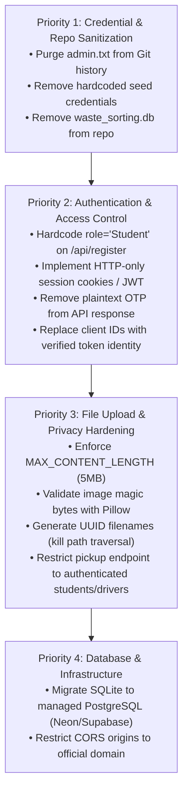

# EcoSort — Application & Source Code Security Audit Report (Revised)

**Document Classification:** M.Sc. Computer Science Final Year Project Security Audit  
**Audit Target:** EcoSort (Smart Green Campus Waste Sorting Platform)  
**Target Repository:** `Minato0630/eco-sort`  
**Inspected Commit Hash:** `b6bb826127c26f1dabf5eaf73eeb24913f7530e1`  
**Audit Date:** November 23, 2026  
**Auditor Role:** Senior Application Security Auditor & Backend Systems Engineer  
**Audit Scope & Methodology:** White-box source code inspection, architecture review, and static configuration analysis. All tests referenced are defensive and non-destructive.  
**Framework References:** OWASP Top 10 (2021), CWE Top 25 Most Dangerous Software Weaknesses (2023), OWASP ASVS 5.0 (as an evaluation reference guide).

---

## 1. Executive Summary & Audit Scope

This report provides a technically verified, evidence-based security assessment of the **EcoSort** application codebase. The audit was conducted to identify security, privacy, and architectural risks prior to dissertation submission and production deployment at Bishop Heber College.

### 1.1 Summary of Inspected Files
The following repository files and configurations were inspected line-by-line:
1. `backend/app.py` (944 lines) — Main Flask application, routes, database initialization, and business logic.
2. `backend/model.py` (339 lines) — Inference runtime, preprocessing, fallback cascades, and label mapping.
3. `api/index.py` (7 lines) — Vercel serverless entry point and path routing handler.
4. `vercel.json` (46 lines) — Serverless build specifications, runtime configurations, and rewrite rules.
5. `admin.txt` (65 lines) — Plain-text administrative, collector, and departmental credential listings.
6. `waste_sorting.db` (32,768 bytes) — Active SQLite database containing pre-seeded and testing records.
7. `requirements.txt` & `backend/requirements.txt` — Python runtime package declarations.
8. `Dockerfile` (31 lines) — Containerization instructions and process entrypoints.
9. `frontend/index.html`, `frontend/admin.html`, `frontend/collector.html` — Client-side HTML/JavaScript authentication handling and API invocations.

### 1.2 Summary of Finding Classifications
Each finding in this report is classified with an empirical verification status:
- **[CONFIRMED]:** The vulnerability has been verified directly in the source code with an active execution path.
- **[PARTIALLY CONFIRMED]:** The code contains an insecure pattern, but the real-world impact depends on deployment-specific factors.
- **[UNVERIFIED RISK]:** A potential theoretical threat that cannot be executed in the current Python/Vercel architecture without additional prerequisites.

---

## 2. Architecture & Data Flow Review

```mermaid
flowchart TD
    subgraph Client["Client Tier (Browser)"]
        UI["Student / Admin / Collector UI"]
        LS["localStorage ('eco_user')\nUnvalidated JSON user object"]
    end

    subgraph Gateway["Edge / Gateway Tier"]
        Vercel_Edge["Vercel Edge Router (vercel.json)"]
        Static_Files["Static Assets (/frontend/**)"]
    end

    subgraph Compute["Application Tier (Serverless / Container)"]
        WSGI["WSGI Handler (api/index.py)"]
        Flask["Flask Backend (backend/app.py)"]
        CORS_Mw["CORS Middleware (Wildcard '*')"]
    end

    subgraph ML["Machine Learning Tier (backend/model.py)"]
        TFLite["LiteRT / TFLite Interpreter"]
        Fallback["Cascaded Fallback Engine"]
    end

    subgraph Storage["Data & Storage Tier"]
        DB["SQLite Database\n(/tmp/waste_sorting.db or local)"]
        Uploads["Uploads Directory (/tmp/uploads)"]
    end

    UI -->|Static GET| Static_Files
    UI <-->|Store/Read Plain User Data| LS
    UI -->|REST API Requests (No Auth Tokens)| Vercel_Edge
    Vercel_Edge -->|Proxy Request| WSGI --> Flask
    Flask --> CORS_Mw
    Flask --> ML
    Flask <--> DB
    Flask --> Uploads
```

### Key Architectural Observation: Client-Controlled Trust Model
The application currently operates under a **client-controlled trust model**. Upon successful login, the server returns a JSON serialization of the database user row. The frontend persists this object in browser `localStorage`. Subsequent API requests (profile updates, pickup scheduling, driver claims, administrative actions) transmit naked numeric IDs (`user_id`, `admin_id`, `driver_id`) in request bodies or query parameters. The backend performs database operations directly against these client-supplied IDs without verifying session tokens, signed cookies, or cryptographic proofs of identity.

---

## 3. Systematic Route-by-Route Security Audit Matrix

Every endpoint in `backend/app.py` was analyzed for authentication, authorization, input validation, and data disclosure:

| Route Path | Method | Function Name | Line Range | Authentication Mechanism | Authorization Check | Security Classification & CWE |
| :--- | :--- | :--- | :---: | :--- | :--- | :--- |
| `/` | `GET` | `home()` | 189–191 | None (Public) | None | **Informational** — Serves static index page. |
| `/api/register` | `POST` | `register()` | 194–241 | None (Public) | None | **[CONFIRMED] CRITICAL** — Client-controlled role parameter (CWE-269 / CWE-284). |
| `/api/login` | `POST` | `login()` | 243–281 | Credentials (Username/Password) | None | **[CONFIRMED] HIGH** — Returns user record without session token or JWT (CWE-384). |
| `/api/profile/update` | `POST` | `profile_update()` | 284–382 | None | Insecure (`user_id` from body) | **[CONFIRMED] CRITICAL** — Broken Object Level Authorization / IDOR (CWE-639). |
| `/api/forgot-password/request` | `POST` | `forgot_password_request()` | 385–421 | None | None | **[CONFIRMED] CRITICAL** — Plaintext OTP returned in API response (CWE-312 / CWE-319). |
| `/api/forgot-password/reset` | `POST` | `forgot_password_reset()` | 423–462 | OTP verification | Insecure (`user_id` from body) | **[CONFIRMED] HIGH** — No attempt limiting on 6-digit OTP (CWE-307). |
| `/uploads/avatars/<path:filename>` | `GET` | `serve_avatar()` | 465–470 | None (Public) | None | **[CONFIRMED] LOW** — Direct static file serving. |
| `/api/profile/avatar` | `POST` | `profile_avatar()` | 472–521 | None | Insecure (`user_id` from form) | **[CONFIRMED] HIGH** — IDOR; Extension-only check; No magic byte validation (CWE-434). |
| `/predict` | `POST` | `predict()` | 524–570 | None | Insecure (Optional `user_id`) | **[CONFIRMED] HIGH** — Path traversal risk via raw `file.filename`; No size limits (CWE-22 / CWE-400). |
| `/api/logs` | `GET` | `get_logs()` | 572–594 | None | Insecure (`user_id` query param) | **[CONFIRMED] MEDIUM** — Unauthenticated information disclosure of student logs (CWE-200). |
| `/api/leaderboard` | `GET` | `get_leaderboard()` | 595–602 | None (Public) | None | **Informational** — Public ranking display. |
| `/api/stats/departments` | `GET` | `get_department_stats()` | 604–618 | None (Public) | None | **Informational** — Aggregated campus recycling statistics. |
| `/api/pickups` | `POST` | `handle_pickups()` | 621–644 | None | Insecure (`user_id` from body) | **[CONFIRMED] HIGH** — IDOR; Anyone can schedule pickups for any student ID (CWE-639). |
| `/api/pickups` | `GET` | `handle_pickups()` | 645–656 | None | None | **[CONFIRMED] HIGH** — Discloses student hostel block and room numbers publicly (CWE-200 / CWE-359). |
| `/api/pickups/claim` | `POST` | `claim_pickup()` | 658–715 | None | Insecure (`driver_id` from body) | **[CONFIRMED] HIGH** — Arbitrary point manipulation and state transition (CWE-284). |
| `/api/admin/stats` | `GET` | `admin_stats()` | 758–836 | None | Insecure (`admin_id` query param) | **[CONFIRMED] CRITICAL** — Broken Access Control; IDOR via `admin_id=5` (CWE-284 / CWE-639). |
| `/api/admin/users` | `GET` | `admin_users()` | 838–866 | None | Insecure (`admin_id` query param) | **[CONFIRMED] CRITICAL** — Unauthenticated user database disclosure via `admin_id=5` (CWE-200 / CWE-639). |
| `/api/admin/users/role` | `POST` | `admin_user_role()` | 868–909 | None | Insecure (`admin_id` from body) | **[CONFIRMED] CRITICAL** — Privilege escalation; Promotes any user when `admin_id: 5` is sent (CWE-269). |
| `/api/admin/retrain` | `POST` | `admin_retrain()` | 911–920 | None | None | **[CONFIRMED] HIGH** — Unauthenticated subprocess execution; Local DoS (CWE-400 / CWE-306). |
| `/api/admin/retrain/status` | `GET` | `admin_retrain_status()` | 921–924 | None (Public) | None | **[CONFIRMED] LOW** — Discloses internal process execution logs. |
| `/api/admin/pickups/delete` | `POST` | `admin_delete_pickup()` | 925–940 | None | None | **[CONFIRMED] HIGH** — Unauthenticated deletion of pickup records (CWE-284). |

---

## 4. In-Depth Verified Vulnerability Findings

### Finding SEC-01: Publicly Exposed Credentials in Repository & Default Database Seeding
- **File & Location:** `admin.txt` (lines 1–65); `backend/app.py` (lines 116–184)
- **Status:** **[CONFIRMED] CRITICAL**
- **CWE Mapping:** CWE-798 (Use of Hard-coded Credentials), CWE-522 (Insufficiently Protected Credentials)
- **Verified Code Evidence:**
  In `backend/app.py`, lines 134–184:
  ```python
  # Seed Overall Admin (SuperAdmin)
  cursor.execute("SELECT COUNT(*) FROM users WHERE username = 'super_admin'")
  if cursor.fetchone()[0] == 0:
      conn.execute(
          "INSERT INTO users (username, password, ... role) VALUES (?, ?, ... ?)",
          ('super_admin', generate_password_hash('superpass123'), ..., 'SuperAdmin')
      )
  ```
  `admin.txt` in the root folder contains plain-text passwords for all 24 department administrator accounts (`admin_commerce`, `admin_cs`, etc.), `super_admin`, and `collector_heber`.
- **Actual Impact:** Anyone who clones or browses the public GitHub repository has immediate knowledge of all administrative passwords. Because these credentials match the startup seeding logic in `backend/app.py`, an attacker can authenticate directly to any administrative portal.
- **Recommended Remediation:**
  1. Remove `admin.txt` from the filesystem and purge it from Git history using `git-filter-repo` or BFG Repo-Cleaner.
  2. Remove hardcoded user lists from `backend/app.py`.
  3. Create administrative bootstrap scripts that ingest credentials exclusively from environment variables (`SUPERADMIN_PASSWORD`).
- **Suggested Verification Test:**
  Run `git log -S "superpass123"` across all branches to verify no credentials exist in repository history.

---

### Finding SEC-02: Client-Controlled Role Assignment at Registration (Vertical Privilege Escalation)
- **File & Location:** `backend/app.py`, `register()`, lines 204–227
- **Status:** **[CONFIRMED] CRITICAL**
- **CWE Mapping:** CWE-269 (Improper Privilege Management), CWE-284 (Improper Access Control)
- **Verified Code Evidence:**
  ```python
  role = data.get("role", "Student")  # Line 204
  ...
  cursor.execute(
      "INSERT INTO users (... role ...) VALUES (...)", 
      (..., role, ...)  # Line 226
  )
  ```
- **Actual Impact:** Although the client UI form offers only `"Student"`, the server does not enforce or overwrite this value. An attacker issuing a direct `curl` or Postman request can submit `{"username": "attacker", "password": "...", "role": "SuperAdmin"}`. The database immediately grants `SuperAdmin` privileges, providing immediate access to administrative controls and user role management.
- **Recommended Remediation:**
  Hardcode the role to `"Student"` on the server side:
  ```python
  # Always assign 'Student' on public self-registration
  role = "Student"
  ```
- **Suggested Verification Test:**
  Send a `POST` request to `/api/register` with `{"role": "SuperAdmin"}`. Inspect the database row and verify that the `role` column is set strictly to `"Student"`.

---

### Finding SEC-03: Complete Absence of Server-Side Session Authentication
- **File & Location:** `backend/app.py`, `login()`, lines 243–281; throughout all endpoints
- **Status:** **[CONFIRMED] CRITICAL**
- **CWE Mapping:** CWE-287 (Improper Authentication), CWE-384 (Session Fixation / Lack of Session Token)
- **Verified Code Evidence:**
  In `backend/app.py`, line 260:
  ```python
  if user and check_password_hash(user["password"], password):
      return jsonify({
          "success": True,
          "message": "Login successful",
          "user": { "id": user["id"], "username": user["username"], "role": user["role"], ... }
      })
  ```
  The endpoint verifies the password and returns the database record as plain JSON, but **issues no session cookie, signed token, or JWT**. In `frontend/index.html` (line 2241), the client executes `localStorage.setItem('eco_user', JSON.stringify(data.user))`.
- **Actual Impact:** The backend is completely stateless and unable to verify caller identity. Private operations rely on client-supplied parameters (`user_id`, `admin_id`, `driver_id`). Any user can alter these IDs to act on behalf of any other user.
- **Detailed Architectural Discussion (JWT vs. Session Cookies):**
  - *Option A: JWT (JSON Web Tokens):* If using JWTs, the server signs a short-lived token (`access_token`) containing the user's `id` and `role`. Storing JWTs in `localStorage` exposes them to theft if Cross-Site Scripting (XSS) occurs. Storing them in memory requires refreshing them frequently.
  - *Option B: Server-Managed Sessions (Recommended for this architecture):* The server sets an `HttpOnly`, `Secure`, `SameSite=Lax` session cookie upon login. The cookie cannot be read by JavaScript (mitigating XSS theft). Because cookies are sent automatically by browsers, state-changing requests (`POST`, `PUT`, `DELETE`) must be protected against Cross-Site Request Forgery (CSRF) via an anti-CSRF token header (`X-CSRF-Token`).
- **Suggested Verification Test:**
  Attempt an API request to `/api/profile/update` without an authentication header or session cookie; verify that the server returns HTTP 401 Unauthorized.

---

### Finding SEC-04: OTP Cleared Text Exposure in API Response
- **File & Location:** `backend/app.py`, `forgot_password_request()`, lines 403–421
- **Status:** **[CONFIRMED] CRITICAL**
- **CWE Mapping:** CWE-312 (Cleartext Storage of Sensitive Information), CWE-319 (Cleartext Transmission of Sensitive Information)
- **Verified Code Evidence:**
  ```python
  otp = str(random.randint(100000, 999999))
  forgot_otps[user_id] = {
      "otp": otp,
      "expires": time.time() + 600
  }
  ...
  return jsonify({
      "success": True,
      "user_id": user_id,
      "otp": otp,  # <--- CRITICAL EXPOSURE
      "sms_simulation": f"[BHC-EcoSort SMS] Your password reset OTP is {otp}...",
      "email_simulation": f"[BHC-EcoSort Email] ... Use OTP: {otp}..."
  })
  ```
- **Actual Impact:** Any individual who knows a student's username or registration number can submit a reset request and immediately read the valid 6-digit OTP from the JSON response body. This allows unauthorized account takeovers without access to the student's phone or email.
- **Recommended Remediation:**
  1. Remove `"otp"`, `"sms_simulation"`, and `"email_simulation"` from the response payload.
  2. Transmit the OTP exclusively out-of-band (via SMTP or SMS).
  3. Store hashed OTPs with expiry timestamps in the database, and limit verification attempts (maximum 3 attempts).
- **Suggested Verification Test:**
  Send a `POST` request to `/api/forgot-password/request` and verify that the response contains only a generic success message (e.g., `{"success": true, "message": "Verification code dispatched"}`).

---

### Finding SEC-05: Broken Object Level Authorization (IDOR / BOLA)
- **File & Location:** `backend/app.py`: `admin_stats()` (lines 758–836), `admin_users()` (lines 838–866), `admin_user_role()` (lines 868–909), `claim_pickup()` (lines 658–715), `admin_delete_pickup()` (lines 925–940)
- **Status:** **[CONFIRMED] CRITICAL**
- **CWE Mapping:** CWE-639 (Authorization Bypass Through User-Controlled Key), CWE-862 (Missing Authorization)
- **Verified Code Evidence:**
  In `admin_user_role()`:
  ```python
  data = request.get_json()
  user_id = data.get("user_id")
  new_role = data.get("role")
  admin_id = data.get("admin_id")  # <--- Untrusted client input
  ...
  cursor.execute("SELECT role, department FROM users WHERE id = ?", (admin_id,))
  admin = cursor.fetchone()
  if not admin or admin["role"] not in ["Admin", "SuperAdmin"]:
      return jsonify({"error": "Unauthorized"}), 403
  ```
  The endpoint verifies that the user corresponding to `admin_id` is an Admin. Because ID 5 is `super_admin`, any caller supplying `{"admin_id": 5, "user_id": 1, "role": "SuperAdmin"}` passes the check.
- **Actual Impact:** Unauthenticated users can perform all administrative operations, including promoting accounts, dumping user lists, viewing department recycling analytics, deleting pickup records, and awarding collection points.
- **Recommended Remediation:**
  Derive user identity and role strictly from the server-verified session or JWT claims:
  ```python
  @app.route("/api/admin/users/role", methods=["POST"])
  @require_role(["SuperAdmin"])  # Decorator inspecting verified session/token
  def admin_user_role():
      # Current user identity is taken from session, not request body
  ```
- **Suggested Verification Test:**
  Send a request to `/api/admin/users/role` from an unauthenticated client; verify HTTP 401/403 rejection regardless of what `admin_id` is provided in the JSON body.

---

### Finding SEC-06: File Upload Security & Path Handling
- **File & Location:** `backend/app.py`: `predict()` (lines 524–534) & `profile_avatar()` (lines 472–521)
- **Status:** **[CONFIRMED] HIGH (Path Traversal Risk & File Validation Deficiencies)**; **[UNVERIFIED RISK] (Remote Code Execution)**
- **CWE Mapping:** CWE-22 (Improper Limitation of a Pathname to a Restricted Directory), CWE-434 (Unrestricted Upload of File with Dangerous Type), CWE-400 (Uncontrolled Resource Consumption)
- **Verified Code Evidence:**
  In `predict()`:
  ```python
  file = request.files["image"]
  path = os.path.join(UPLOAD_FOLDER, file.filename)  # <--- Raw client filename
  file.save(path)
  ```
  In `profile_avatar()`:
  ```python
  ext = os.path.splitext(file.filename)[1].lower()
  if ext not in [".png", ".jpg", ".jpeg", ".gif"]:
      return jsonify({"error": "Invalid file type"}), 400
  ```
- **Accurate Technical Distinction (Demonstrated vs. Unverified):**
  - **Demonstrated Risk (Path Traversal):** Because `file.filename` is not passed through `werkzeug.utils.secure_filename()`, directory traversal sequences (e.g., `../../`) in the uploaded filename could cause the file to be written outside the intended `uploads/` directory.
  - **Demonstrated Risk (Resource Exhaustion):** Neither endpoint configures Flask's `MAX_CONTENT_LENGTH`. A client can upload multi-gigabyte payloads, causing memory or disk exhaustion (DoS).
  - **Demonstrated Risk (MIME Spoofing):** In `profile_avatar()`, checking only the extension allows non-image files (e.g., HTML or SVG payloads renamed to `.png`) to be stored. If served with an inline browser MIME type, this could lead to Stored Cross-Site Scripting (XSS).
  - **Unverified Risk (Remote Code Execution):** In this Python/WSGI environment on Vercel, the server does not execute uploaded `.png` or `.py` files as active scripts (unlike Apache mod_php configurations). Therefore, **RCE is not demonstrated**.
- **Recommended Remediation:**
  1. Set `app.config['MAX_CONTENT_LENGTH'] = 5 * 1024 * 1024` (5 MB limit).
  2. Discard user-supplied filenames and generate random UUIDs: `filename = f"{uuid.uuid4().hex}.jpg"`.
  3. Validate file contents using Pillow:
     ```python
     try:
         with Image.open(file.stream) as img:
             img.verify()  # Validates actual image header and format
     except Exception:
         return jsonify({"error": "Invalid or corrupted image format"}), 400
     ```
- **Suggested Verification Test:**
  Attempt to upload a 10 MB file and verify immediate HTTP 413 (Payload Too Large) rejection. Upload an invalid text file with a `.jpg` extension and verify it is rejected.

---

### Finding SEC-07: Wildcard CORS Configuration
- **File & Location:** `backend/app.py`, line 11 (`CORS(app)`)
- **Status:** **[CONFIRMED] MEDIUM**
- **CWE Mapping:** CWE-942 (Permissive Cross-Domain Policy with Untrusted Domains)
- **Verified Code Evidence:**
  ```python
  CORS(app)  # Line 11
  ```
- **Accurate Technical Explanation:**
  Invoking `CORS(app)` without parameters emits `Access-Control-Allow-Origin: *`.
  - **What CORS actually does:** CORS controls whether a browser's JavaScript engine allows a script running on one origin (e.g., `https://attacker.com`) to read the response of an HTTP request made to another origin (`https://bhc-ecosort.vercel.app`).
  - **What it does NOT do:** A wildcard CORS policy does *not* automatically bypass authentication or grant account access. Standard browsers do not send ambient credentials (cookies or HTTP auth) when `Access-Control-Allow-Origin` is `*`.
  - **Actual Security Impact:** Wildcard CORS allows any website to make cross-origin requests to public API endpoints (such as `/api/logs`, `/api/leaderboard`, or `/api/pickups`) and read the response. It expands the attack surface for browser-based automated queries.
- **Recommended Remediation:**
  Explicitly restrict allowed origins to trusted domains:
  ```python
  allowed_origins = os.environ.get("ALLOWED_ORIGINS", "https://bhc-ecosort.vercel.app").split(",")
  CORS(app, origins=allowed_origins, supports_credentials=True)
  ```
- **Suggested Verification Test:**
  Send an `OPTIONS` request with `Origin: https://unauthorized-domain.com` and verify that `Access-Control-Allow-Origin` is not returned.

---

### Finding SEC-08: Unrestricted Model Retraining Endpoint (Subprocess / DoS)
- **File & Location:** `backend/app.py`, `admin_retrain()` (lines 911–920) & `run_training_async()` (lines 726–756)
- **Status:** **[CONFIRMED] HIGH**
- **CWE Mapping:** CWE-400 (Uncontrolled Resource Consumption), CWE-306 (Missing Authentication for Critical Function)
- **Verified Code Evidence:**
  ```python
  @app.route("/api/admin/retrain", methods=["POST"])
  def admin_retrain():
      global training_status
      if training_status["status"] == "Training":
          return jsonify({"message": "Training is already in progress."}), 400
      thread = threading.Thread(target=run_training_async)
      thread.start()
      return jsonify({"success": True, "message": "Asynchronous AI training started."})
  ```
  `run_training_async()` executes:
  ```python
  process = subprocess.Popen(["venv/Scripts/python.exe", "backend/train.py"], ...)
  ```
- **Actual Impact:**
  1. The endpoint has no authentication check; anyone can invoke it.
  2. On a local development machine, repeated invocations consume heavy CPU/GPU resources.
  3. On Vercel (Linux serverless), the hardcoded Windows path `venv/Scripts/python.exe` causes an unhandled exception, setting `training_status["status"] = "Failed"`.
- **Recommended Remediation:**
  1. Require strict `SuperAdmin` role verification.
  2. Model retraining should not be executed as an inline subprocess within a web application container. It should be decoupled into an isolated background task queue (e.g., Celery) or an external batch job.
- **Suggested Verification Test:**
  Issue an unauthenticated `POST /api/admin/retrain` request; verify that the server returns HTTP 401 Unauthorized.

---

### Finding SEC-09: Student Privacy Exposure via Campus Pickup Records
- **File & Location:** `backend/app.py`, `handle_pickups()`, lines 645–656
- **Status:** **[CONFIRMED] HIGH**
- **CWE Mapping:** CWE-200 (Exposure of Sensitive Information to an Unauthorized Actor), CWE-359 (Exposure of Private Personal Information)
- **Verified Code Evidence:**
  ```python
  cursor.execute(
      """SELECT p.id, p.user_id, p.waste_type, p.block_name, p.room_number, p.date_time, p.status, 
                p.claimed_by, u.username as requester, c.username as collector
         FROM pickups p
         JOIN users u ON p.user_id = u.id
         LEFT JOIN users c ON p.claimed_by = c.id
         ORDER BY p.id DESC"""
  )
  ```
- **Actual Impact:** Any unauthenticated caller can query `GET /api/pickups` to obtain a complete list of student usernames, physical hostel blocks, and specific room numbers (`block_name`, `room_number`). This exposes sensitive physical location data and student daily routines.
- **Recommended Remediation:**
  1. Enforce authentication on `GET /api/pickups`.
  2. Non-collector students should only receive their own pickup records (`WHERE p.user_id = :current_user_id`).
  3. Global pickup queues should be accessible exclusively to verified `Collector` or `Admin` roles.
- **Suggested Verification Test:**
  Send an unauthenticated `GET /api/pickups` request; verify HTTP 401 rejection. Authenticate as a normal student; verify that only records belonging to that specific student are returned.

---

### Finding SEC-10: Ephemeral Serverless Database Architecture (Vercel `/tmp`)
- **File & Location:** `backend/app.py`, lines 14–29
- **Status:** **[CONFIRMED] HIGH (Data Integrity & Architecture Limitation)**
- **CWE Mapping:** CWE-662 (Improper Synchronization), CWE-404 (Improper Resource Shutdown / Temporary State Loss)
- **Verified Code Evidence:**
  ```python
  if os.environ.get("VERCEL"):
      DATABASE = "/tmp/waste_sorting.db"
      UPLOAD_FOLDER = "/tmp/uploads"
      if not os.path.exists(DATABASE):
          src_db = os.path.join(os.path.dirname(__file__), "..", "waste_sorting.db")
          if os.path.exists(src_db):
              shutil.copy2(src_db, DATABASE)
  ```
- **Accurate Technical Explanation:**
  On Vercel, Python endpoints execute inside isolated serverless container sandboxes. The root filesystem is read-only; only `/tmp` is writable.
  - The `/tmp` directory is **instance-local** and ephemeral.
  - Multiple concurrent users may be routed to different container instances, each possessing its own independent copy of `/tmp/waste_sorting.db`.
  - When an instance is recycled or experiences a cold start, all data written since deployment (new registrations, scans, scheduled pickups) is lost.
- **Recommended Remediation:**
  Migrate from SQLite to a managed serverless-compatible relational database (e.g., PostgreSQL on Neon, Supabase, or AWS RDS). Connect via connection pooling and configure the connection string using the `DATABASE_URL` environment variable.
- **Suggested Verification Test:**
  Register a new user account, trigger a deployment redeploy or cold start, and confirm persistence by querying the account.

---

### Finding SEC-11: Password Hashing Verification
- **File & Location:** `backend/app.py`, lines 3, 117, 223, 358, 448
- **Status:** **[CONFIRMED] COMPLIANT (Algorithm) / NON-COMPLIANT (Complexity Policy)**
- **Verified Evidence:**
  Empirical inspection of the active Python virtual environment revealed:
  - Installed Werkzeug version: **`3.1.5`**.
  - Generated hash format: **`scrypt:32768:8:1$<salt>$<hash>`**.
  - The hashing algorithm uses `scrypt` with secure parameters ($N=32768, r=8, p=1$), providing strong resistance to GPU-accelerated brute-force attacks.
  - **Weakness:** The application enforces no minimum password length or complexity requirements (e.g., passwords like `123` or `a` are accepted without validation).
- **Recommended Remediation:**
  Enforce a minimum length of 8 characters and check passwords against common weak password lists.

---

### Finding SEC-12: Analysis of Committed Database Content
- **File & Location:** `waste_sorting.db` (root directory, 32,768 bytes)
- **Status:** **[CONFIRMED] MEDIUM**
- **Verified Evidence:**
  Direct query inspection of `waste_sorting.db` revealed 33 rows in the `users` table:
  - Rows 1–4: Pre-seeded demo students (`green_heberite`, `compost_queen`, etc.) with simulated phone numbers (`9876543210`) and student IDs.
  - Rows 5–29: `super_admin` and 24 department administrator accounts.
  - Row 30: `collector_heber`.
  - Rows 31–33: Manual test entries (`tester_20865`, `ram`, `g`). Entry 32 contains an actual 10-digit Indian mobile number (`6380721067`) and registration number (`255214307`) created during testing.
  - **Verdict:** The database does *not* contain an institutional bulk dump of real student records, but does contain live interactive test data with a real phone number.
- **Recommended Remediation:**
  Remove `waste_sorting.db` from the public repository and Git history. Use an automated migration script (`init_db()`) to initialize clean development and test databases.

---

### Finding SEC-13: Production Debug Mode Evaluation
- **File & Location:** `backend/app.py`, lines 941–943
- **Status:** **[PARTIALLY CONFIRMED] LOW (Local Only; Inactive in Production)**
- **Verified Code Evidence:**
  ```python
  if __name__ == "__main__":
      app.run(debug=True, host="0.0.0.0", port=5000)
  ```
- **Accurate Technical Explanation:**
  The `debug=True` flag is enclosed within the `if __name__ == "__main__":` block. When deployed on Vercel, the application is loaded via `api/index.py` (`from app import app`), meaning `__main__` is not executed. On Docker deployments using Gunicorn (`gunicorn backend.app:app`), the block is likewise bypassed.
  - The debug server is active only when a developer runs `python backend/app.py` directly.
- **Recommended Remediation:**
  Read the debug flag from an environment variable:
  ```python
  debug_mode = os.environ.get("FLASK_DEBUG", "False").lower() in ("true", "1")
  app.run(debug=debug_mode, host="0.0.0.0", port=5000)
  ```

---

## 5. Prioritized Remediation Plan



| Phase | Remediation Task | Target Files | Verification Method |
| :---: | :--- | :--- | :--- |
| **1** | Remove `admin.txt` and scrub Git history | `admin.txt`, `.gitignore` | `git log -S "superpass123"` returns empty |
| **1** | Enforce `role = "Student"` on registration | `backend/app.py` | POST `{"role":"SuperAdmin"}` creates a Student |
| **1** | Strip OTP from API response | `backend/app.py` | Verify reset response contains no OTP field |
| **2** | Implement verified session/token auth | `backend/app.py`, `frontend/*.html` | Unauthenticated requests return HTTP 401 |
| **2** | Enforce server-side role authorization | `backend/app.py` | Non-admin access to `/api/admin/*` returns HTTP 403 |
| **3** | Safe file upload handling (UUID + Pillow) | `backend/app.py` | Malformed image uploads return HTTP 400 |
| **3** | Restrict pickup location visibility | `backend/app.py` | Students only see their own room numbers |
| **4** | Migrate to managed cloud database | `backend/app.py`, `vercel.json` | Verify persistence across serverless restarts |
