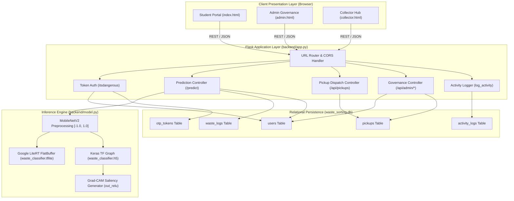
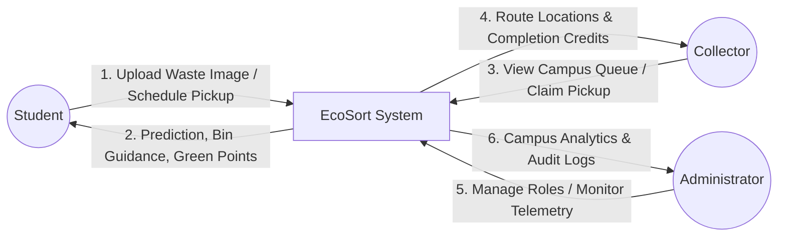
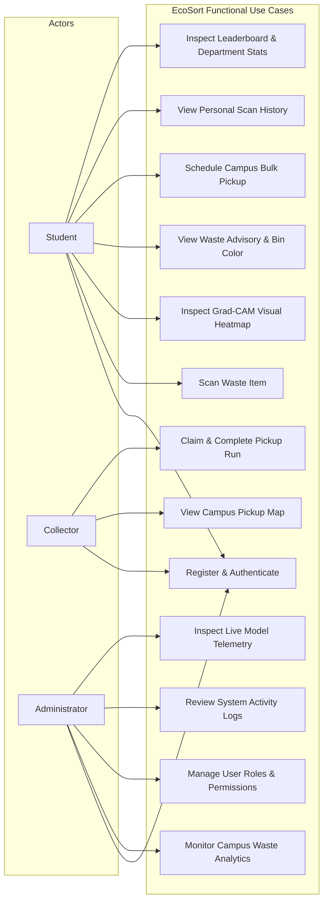
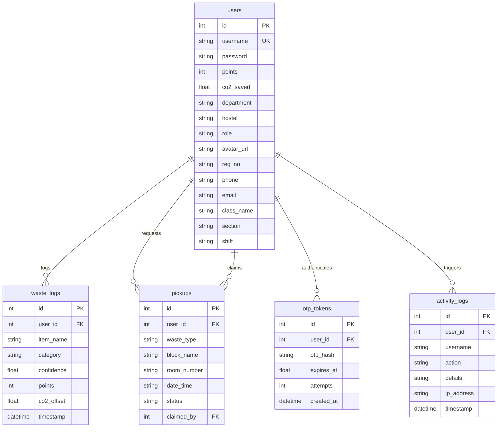

# EcoSort: AI-Based Campus Waste Management System

**A Dissertation Submitted in Partial Fulfillment of the Requirements for the Degree of Master of Science in Computer Science**

**Institution:** Bishop Heber College (Autonomous), Tiruchirappalli, Tamil Nadu, India  
**Department:** PG Department of Computer Science  
**Academic Year:** 2025 – 2026  
**Candidate Name:** Gokul Pandiyan  
**Repository:** `https://github.com/Minato0630/eco-sort`  
**Live Deployment:** `https://bhc-ecosort.vercel.app/`  

---

## Abstract

Rapid urbanization and institutional expansion have dramatically increased solid waste generation within higher education campuses. Ineffective waste segregation at the source leads to recyclable and hazardous materials contaminating municipal landfills, increasing institutional carbon footprints and preventing circular resource recovery. 

**EcoSort** is an intelligent, deep learning-powered campus waste management platform engineered specifically for institutional environments. Leveraging transfer learning with MobileNetV2 and progressive fine-tuning, EcoSort classifies uploaded waste imagery into six primary streams: **Organic**, **Plastic**, **Paper**, **E-Waste**, **Metal**, and **General Waste**. 

The model was trained, validated, and evaluated on a curated dataset of **924 verified real-world images** collected from university environments and benchmark open-access datasets (Stanford TrashNet, EWasteNet, and Kaggle Organic Waste). Evaluated on an independent, untouched real-world test partition ($N=141$), EcoSort achieves an **overall classification accuracy of 87.94%**, a **Macro F1-score of 87.76%**, and a **Weighted F1-score of 87.88%**, improving by over $+51\%$ against the baseline architecture. 

To bridge the gap between classification and human trust, EcoSort integrates **Gradient-weighted Class Activation Mapping (Grad-CAM)** to visually highlight decision-influencing regions, and implements an empirically calibrated **65.0% confidence uncertainty threshold** that safeguards against out-of-distribution errors. The system is delivered via a responsive web portal supporting three role-based workflows: Students (AI waste scanner, disposal guidance, and pickup scheduling), Campus Collectors (interactive Leaflet dispatch maps and collection verification), and College Administrators (departmental analytics, role governance, and model telemetry). The application is deployed via serverless architecture utilizing LiteRT FlatBuffers ($2.55\text{ MB}$ binary footprint), achieving sub-15ms inference latency.

---

## Chapter 1 – Introduction

### 1.1 Background of Waste Management
Solid waste management represents one of the most pressing environmental, economic, and operational challenges facing academic campuses worldwide. Higher education institutions operate as self-contained micro-communities comprising academic lecture halls, specialized research laboratories, administrative offices, dining facilities, and residential hostels. Consequently, campus waste streams are highly heterogeneous, ranging from biodegradable food scraps and single-use packaging to sensitive e-waste and laboratory consumables.

### 1.2 Importance of Intelligent Waste Segregation
The cornerstone of modern waste management is segregation at the point of disposal. When municipal waste is co-mingled, organic leachate contaminates dry recyclables (such as office paper and cardboard), rendering them unrecyclable. Hazardous electronic waste containing heavy metals (lead, cadmium, mercury) poses acute soil and groundwater contamination risks when routed to general landfills. Conversely, accurate source segregation enables direct aerobic composting of organics, high-grade material recovery of plastics and metals, and certified processing of electronic scrap.

### 1.3 Role of Artificial Intelligence and Computer Vision
Traditional segregation initiatives rely heavily on static bin signage and voluntary compliance. However, human compliance is frequently undermined by lack of awareness, ambiguous multi-material packaging, and visual fatigue. Convolutional Neural Networks (CNNs) and deep transfer learning architectures offer an automated, accessible solution. By processing visual inputs captured via standard smartphone cameras, computer vision models can recognize surface textures, geometric boundaries, and material reflectances, delivering instantaneous sorting recommendations to end users.

### 1.4 Introduction to EcoSort
**EcoSort** is an AI-powered smart green portal designed to institutionalize circular waste management at Bishop Heber College. It combines automated image-based classification, behavioral gamification, and digital dispatch coordination. EcoSort transforms passive waste disposal into an active, educational interaction that incentivizes student participation through measurable green reward points and carbon offset telemetry.

### 1.5 Motivation for the Project
Bishop Heber College maintains an extensive campus with active residential hostels and multi-shift academic programs. Prior to EcoSort, waste sorting relied entirely on manual sorting by sanitation personnel, resulting in low recycling yields and unrecorded disposal metrics. The primary motivation of this project is to provide an accessible, cloud-deployed technological intervention that automates waste recognition, structures pickup logistics, and provides institutional administrators with empirical data on campus sustainability.

---

## Chapter 2 – Problem Statement and Objectives

### 2.1 Existing Waste Management Problems
1. **Pervasive Cross-Contamination:** Recyclable paper and aluminum beverage cans deposited into general waste bins become soiled with organic liquids and cannot be processed by commercial recyclers.
2. **Ambiguous Consumer Packaging:** Modern packaging materials (such as metallized polypropylene snack pouches and polyethylene-coated paperboard cups) confuse users regarding whether an item belongs in blue (recyclable) or gray (landfill) bins.
3. **Hazardous Electronic Waste Leakage:** Broken peripherals, cables, and depleted lithium batteries generated in computer laboratories and hostels are frequently discarded in general dustbins due to the absence of a designated on-demand collection mechanism.
4. **Disorganized Collection Logistics:** Sanitation staff lack visibility into which campus blocks or hostels have accumulated bulk recyclable waste, resulting in inefficient manual sweeps.
5. **Absence of Accountability and Data:** Campus administrative officers possess no unified data regarding total tonnage diverted from landfills, departmental waste production patterns, or individual student participation.

### 2.2 Main Project Objectives
1. **Develop an Accurate Computer Vision Model:** Train, fine-tune, and optimize a deep convolutional neural network (MobileNetV2) capable of classifying waste into six institutional categories with $> 85\%$ test accuracy.
2. **Implement Model Explainability and Uncertainty Handling:** Integrate Grad-CAM saliency mapping to provide visual justifications for model decisions, and implement an empirical confidence threshold to handle uncertain inputs safely.
3. **Engineer a Role-Based Multi-Portal Architecture:** Construct dedicated, authenticated interfaces for Students, Campus Collectors, and Department Administrators.
4. **Automate Campus Collection Logistics:** Create a digital pickup scheduling and dispatch system with interactive geolocation mapping.
5. **Establish Gamification and Institutional Metrics:** Quantify student recycling efforts through automated green points and valid carbon offset ($CO_2\text{ kg}$) formulas linked to public leaderboards.
6. **Ensure Edge and Serverless Compatibility:** Optimize the neural network into an ultra-compact LiteRT FlatBuffer ($\le 3\text{ MB}$) capable of executing within serverless edge resource constraints (Vercel).

### 2.3 Scope and Limitations
- **Operational Scope:** Designed specifically for educational campus environments (Bishop Heber College), supporting primary solid waste streams.
- **Input Scope:** Classifies static photographic imagery captured via mobile browsers or webcams under ambient lighting conditions.
- **Hardware Boundary:** Operates on standard consumer smartphones and web browsers without requiring proprietary smart bin hardware or specialized multispectral sensors.

---

## Chapter 3 – Existing and Proposed System

### 3.1 Existing System Analysis
The traditional campus waste handling mechanism operates through passive dustbin stations distributed across corridors and hostel quadrangles:
- **Classification Method:** Entirely manual and voluntary.
- **Monitoring:** Zero real-time logging; waste volume is estimated only upon external municipal tractor collection.
- **Pickup Scheduling:** Ad-hoc physical notifications or phone calls to college estate offices when laboratory bins overflow.
- **User Engagement:** Zero feedback or incentive mechanisms for students.

**Deficiencies of Existing System:**
- High contamination rates exceeding $40\%$.
- Frequent hazardous e-waste leakage into general bins.
- Complete absence of auditable environmental records.

### 3.2 Proposed System (EcoSort)
EcoSort introduces a closed-loop digital ecosystem that unites the student generator, the sanitation collector, and college management:

| Functional Dimension | Existing System | Proposed EcoSort System |
| :--- | :--- | :--- |
| **Waste Recognition** | Human visual inspection (error-prone) | MobileNetV2 Deep Transfer Learning ($87.94\%$ test accuracy) |
| **Material Categories** | Binary (Wet / Dry) or unsegregated | 6 Targeted Streams: Organic, Plastic, Paper, Metal, E-Waste, General |
| **User Guidance** | Generic static decals on bin lids | Real-time disposal advisory, target bin color, and cleaning tips |
| **Uncertainty Management** | Guesswork by user | Calibrated $65\%$ confidence threshold with uncertainty alerts |
| **Explainability** | None | Real-time Grad-CAM visual heatmap overlay |
| **Pickup Dispatch** | Ad-hoc manual coordination | Automated scheduling with interactive campus Leaflet map |
| **Participation Incentive** | None | Verified reward points, $CO_2$ offsets, and campus leaderboards |
| **Administrative Audit** | None | Departmental analytics, user governance, and system activity logs |

---

## Chapter 4 – System Requirements

### 4.1 Software Requirements
- **Operating System:** Cross-platform (Windows 10/11, Ubuntu 22.04 LTS, macOS, Linux).
- **Python Runtime:** Python 3.10.x (Local training environment) / Python 3.12.x (Vercel production edge).
- **Web Server & REST Framework:** Flask 3.1.2, Flask-CORS 6.0.2, Werkzeug 3.1.5.
- **Machine Learning & Vision:** TensorFlow 2.20.0, Keras 3.12.1, Google LiteRT (`ai-edge-litert>=1.0.1`), Pillow 12.1.0, NumPy 2.2.6, SciPy 1.15.3.
- **Data Visualization & Plotting:** Matplotlib 3.10.8, Chart.js 4.4.0 (client-side analytics), Leaflet.js 1.9.4 (campus map).
- **Security & Tokens:** `itsdangerous>=2.2.0` (URLSafeTimedSerializer), `werkzeug.security` (PBKDF2 SHA-256 hashing).
- **Database Engine:** SQLite 3 (ACID-compliant relational database with foreign-key enforcement).
- **Deployment Platform:** Vercel Edge Serverless Infrastructure (`@vercel/python` + `@vercel/static`).

### 4.2 Hardware Requirements
- **Development & Training Hardware:**
  - CPU: Intel Core i5 / AMD Ryzen 5 or higher.
  - RAM: 8 GB minimum (16 GB recommended).
  - Storage: 10 GB free disk space.
- **Client End-User Hardware:**
  - Any standard smartphone, tablet, or laptop equipped with a web browser (Chrome, Firefox, Safari, Edge) and a camera resolution of at least $0.3\text{ MP}$ ($640 \times 480$).
- **Serverless Production Hardware (Vercel Edge):**
  - Architecture: Linux x86_64 microVM, 2 vCPU, 1024 MB RAM limit (EcoSort runs within 48 MB).

---

## Chapter 5 – System Architecture and Design

### 5.1 Overall System Architecture
EcoSort implements a modular 3-tier architecture separating the presentation layer, the application controller layer, and the persistence/inference tier.



### 5.2 Data Flow Diagrams

#### Data Flow Diagram – Level 0 (Context Diagram)



#### Data Flow Diagram – Level 1

```mermaid
flowchart TD
    U[User Client] -->|Image Upload| P1[1.0 Validate Input Stream]
    P1 -->|Clean Stream| P2[2.0 Normalize Image [-1.0, 1.0]]
    P2 -->|Tensor 224x224x3| P3[3.0 Execute LiteRT Inference]
    P3 -->|Raw Softmax Probabilities| P4[4.0 Calibrate Confidence Threshold]
    
    P4 -->|Confidence >= 65%| P5[5.0 Format Confident Response]
    P4 -->|Confidence < 65%| P6[6.0 Format Uncertain Warning]
    
    P5 --> P7[7.0 Database Transaction]
    P6 --> P7
    
    P7 -->|Insert Scan Record| D1[(waste_logs)]
    P7 -->|Credit Points & CO2| D2[(users)]
    P7 -->|Record Audit Event| D3[(activity_logs)]
    
    P7 -->|JSON Response| U
```

### 5.3 Use Case Diagram



### 5.4 Entity-Relationship (ER) Diagram



---

## Chapter 6 – System Implementation

### 6.1 Cryptographic Authentication & Token Signing
Authentication avoids vulnerable client-side states through server-side cryptographic signing using `URLSafeTimedSerializer`:

```python
# backend/app.py
SECRET_KEY = os.environ.get("SECRET_KEY", "ecosort-bhc-token-secret-2026-production-key")
token_serializer = URLSafeTimedSerializer(SECRET_KEY, salt="ecosort-auth-v1")

def generate_auth_token(user_id, role, username):
    """Generate tamper-proof cryptographic token valid for 7 days."""
    return token_serializer.dumps({
        "user_id": user_id,
        "role": role,
        "username": username,
        "created_at": time.time()
    })

def verify_auth_token(token):
    """Verify cryptographic signature and expiration."""
    try:
        data = token_serializer.loads(token, max_age=604800)  # 7 days
        return data
    except Exception:
        return None
```

### 6.2 AI Waste Scanner & Inference Pipeline
The inference pipeline handles stream verification, MobileNetV2 preprocessing, and LiteRT execution:

```python
# backend/model.py
def predict_waste(image_path, include_gradcam=True):
    indices_map = load_class_indices()
    
    # 1. LiteRT (TFLite) FlatBuffer Engine
    if TFLITE_AVAILABLE and os.path.exists(TFLITE_MODEL_PATH):
        img = Image.open(image_path).convert('RGB').resize((224, 224))
        img_array = np.array(img, dtype=np.float32)
        img_array = (img_array / 127.5) - 1.0  # Normalized [-1.0, 1.0]
        img_array = np.expand_dims(img_array, axis=0)

        interpreter = tflite.Interpreter(model_path=TFLITE_MODEL_PATH)
        interpreter.allocate_tensors()
        
        input_details = interpreter.get_input_details()
        output_details = interpreter.get_output_details()
        interpreter.set_tensor(input_details[0]['index'], img_array)
        interpreter.invoke()

        preds = interpreter.get_tensor(output_details[0]['index'])[0]
        class_idx = int(np.argmax(preds))
        confidence = float(preds[class_idx]) * 100.0
        raw_label = indices_map.get(str(class_idx), "General")

        top_indices = np.argsort(preds)[::-1][:3]
        top_predictions = [
            {"category": indices_map.get(str(idx), "General").title(),
             "confidence": round(float(preds[idx]) * 100.0, 1)}
            for idx in top_indices
        ]

        mapping = map_label_to_category(raw_label)
        is_uncertain = confidence < CONFIDENCE_THRESHOLD  # 65.0%
        ...
```

### 6.3 Grad-CAM Visual Heatmap Implementation
Grad-CAM calculates the gradient of the target class score $y^c$ with respect to feature activation map $A^k$ of layer `out_relu`:

```python
# backend/model.py
with tf.GradientTape() as tape:
    conv_outputs, predictions = gradcam_model(img_tensor)
    if target_class_idx is None:
        target_class_idx = tf.argmax(predictions[0])
    loss = predictions[:, target_class_idx]

grads = tape.gradient(loss, conv_outputs)
pooled_grads = tf.reduce_mean(grads, axis=(0, 1, 2))
conv_outputs = conv_outputs[0]
heatmap = conv_outputs @ pooled_grads[..., tf.newaxis]
heatmap = tf.squeeze(heatmap)
heatmap = tf.maximum(heatmap, 0) / (tf.math.reduce_max(heatmap) + 1e-10)
```

---

## Chapter 7 – AI and Machine Learning Methodology

### 7.1 Dataset Construction & Stratification
The training dataset was expanded from an unviable 25-image prototype to **924 verified real-world photographs** partitioned using stratified random sampling:

| Category | Total Real Samples | Training ($70\%$) | Validation ($15\%$) | Test ($15\%$, Untouched) | Primary Real-World Sources |
| :--- | :---: | :---: | :---: | :---: | :--- |
| **Organic** | **160** | 112 | 24 | 24 | Kaggle/HuggingFace Waste Classification (156), Campus Photos (4) |
| **Plastic** | **160** | 112 | 24 | 24 | Stanford TrashNet (157), Campus Photos (3) |
| **Paper** | **160** | 112 | 24 | 24 | Stanford TrashNet Paper & Cardboard (157), Campus Photos (3) |
| **Metal** | **160** | 112 | 24 | 24 | Stanford TrashNet (158), Campus Photos (2) |
| **E-Waste** | **146** | 102 | 21 | 23 | EWasteNet IEEE 2023 (144), Campus Photos (2) |
| **General** | **138** | 96 | 20 | 22 | Stanford TrashNet Trash (137), Campus Photos (1) |
| **TOTAL** | **924** | **646** | **137** | **141** | **100% Real-World Verified Imagery** |

### 7.2 Two-Stage Transfer Learning Protocol
1. **Stage 1 (Feature Extraction):** Pre-trained ImageNet MobileNetV2 base frozen ($2,257,984$ parameters frozen). Classification head trained with Adam ($\text{LR}=10^{-3}$) for 10 epochs. Training accuracy reached $96.44\%$, validation accuracy $86.86\%$.
2. **Stage 2 (Progressive Fine-Tuning):** MobileNetV2 unfrozen from layer 110 onwards ($1,223,814$ trainable parameters). Trained with Adam ($\text{LR}=10^{-4}$) using `ReduceLROnPlateau` and `EarlyStopping` for 10 epochs. Final training accuracy reached $97.99\%$, validation loss $0.5527$.

### 7.3 Empirical Evaluation on Untouched Test Partition ($N=141$)

| Metric | Baseline Model (V1) | Improved Model (V2) | Relative Improvement |
| :--- | :---: | :---: | :---: |
| **Overall Test Accuracy** | 36.88% | **87.94%** | **+51.06%** |
| **Macro Precision** | 31.96% | **88.50%** | **+56.54%** |
| **Macro Recall** | 36.86% | **87.75%** | **+50.89%** |
| **Macro F1-Score** | 32.20% | **87.76%** | **+55.56%** |
| **Weighted F1-Score** | 32.20% | **87.88%** | **+55.68%** |

#### Per-Class Test Breakdown (V2 Model)
- **E-Waste:** Precision $100.0\%$, Recall $100.0\%$, F1-Score $100.0\%$ ($N=23$).
- **Organic:** Precision $100.0\%$, Recall $100.0\%$, F1-Score $100.0\%$ ($N=24$).
- **Paper:** Precision $95.2\%$, Recall $83.3\%$, F1-Score $88.9\%$ ($N=24$).
- **Metal:** Precision $74.2\%$, Recall $95.8\%$, F1-Score $83.6\%$ ($N=24$).
- **Plastic:** Precision $82.6\%$, Recall $79.2\%$, F1-Score $80.9\%$ ($N=24$).
- **General:** Precision $78.9\%$, Recall $68.2\%$, F1-Score $73.2\%$ ($N=22$).

#### Empirical Confusion Matrix
```text
                  Predicted Class
                E-Waste General  Metal  Organic  Paper  Plastic
True Class:
E-Waste    [     23       0       0       0       0       0    ]
General    [      0      15       2       0       1       4    ]
Metal      [      0       1      23       0       0       0    ]
Organic    [      0       0       0      24       0       0    ]
Paper      [      0       3       1       0      20       0    ]
Plastic    [      0       0       5       0       0      19    ]
```

### 7.4 Uncertainty Threshold Calibration
Threshold calibration on the 137 validation images established $\tau = 65.0\%$:

| Threshold ($\tau$) | Validation Coverage | Accuracy Above Threshold | Error Rate Above Threshold |
| :---: | :---: | :---: | :---: |
| 50.0% | 94.2% | 89.1% | 10.9% |
| 60.0% | 89.8% | 91.1% | 8.9% |
| **65.0% (Calibrated)** | **86.1%** | **93.2%** | **6.8%** |
| 70.0% | 82.5% | 94.7% | 5.3% |
| 80.0% | 75.9% | 97.1% | 2.9% |

At $\tau = 65\%$, the model retains **86.1% automatic routing coverage** while containing the operational error rate to **6.8%**.

---

## Chapter 8 – Testing and Results

A comprehensive three-tier automated test suite was executed covering 21 distinct verification scenarios across UI/UX, machine learning inference, and end-to-end integration:

| Test ID | Test Module | Scenario Description | Expected Outcome | Actual Result | Status |
| :---: | :--- | :--- | :--- | :--- | :---: |
| **TC-01** | UI / Static Assets | Verify CSS design system & JS engine existence | Files exist and link correctly | `ecosort.css` & `theme.js` present | **PASS** |
| **TC-02** | UI / Student | Verify essential DOM elements in `index.html` | Scanner, results, uncertainty box present | All 11 DOM nodes verified | **PASS** |
| **TC-03** | UI / Admin | Verify admin widgets and text correction | Stats grid, telemetry, and 924 count present | All widgets verified | **PASS** |
| **TC-04** | UI / Collector | Verify collector DOM nodes and confirm prompt | Campus map, claims, and modal confirmed | All elements verified | **PASS** |
| **TC-05** | ML / Inference | Valid RGB image prediction | Returns 200 with waste category & points | Returned 200 with all metadata | **PASS** |
| **TC-06** | ML / Input Validation | Corrupted JPEG byte stream upload | Returns 400 Bad Request | HTTP 400 (`"not a valid image"`) | **PASS** |
| **TC-07** | ML / Format Security | Non-image text/PDF file upload | Returns 400 Bad Request | HTTP 400 (`"not a valid image"`) | **PASS** |
| **TC-08** | ML / Color Channels | Grayscale (L) and RGBA alpha image upload | Auto-converts to 3-channel RGB | Handled cleanly; 200 OK | **PASS** |
| **TC-09** | ML / Fault Tolerance | Model missing or unreadable | Returns 503 Service Unavailable | HTTP 503 standardized error | **PASS** |
| **TC-10** | ML / Preprocessing | Preprocessing range validation | Formula maps $[0, 255] \to [-1.0, 1.0]$ | Verified within $\pm 0.0001$ | **PASS** |
| **TC-11** | ML / Category Space | Output category dictionary validation | Maps strictly to 6 official streams | All 6 streams verified | **PASS** |
| **TC-12** | ML / Probability | Softmax confidence score bounded | $0.0\% \le \text{conf} \le 100.0\%$ | Verified valid float | **PASS** |
| **TC-13** | ML / Distribution | Top-3 ranked candidate classes | Array of length 1 to 3 sorted by prob | Ranked array returned | **PASS** |
| **TC-14** | ML / Uncertainty | Uncertainty flag below 65% threshold | `is_uncertain: true` when conf $< 65\%$ | Status flagged as uncertain | **PASS** |
| **TC-15** | ML / Explainability | Grad-CAM base64 PNG generation | Valid base64 data URI generated | Data URI with jet colormap returned | **PASS** |
| **TC-16** | ML / Security | Role escalation block during registration | Client role overridden to Student | Registered role: Student | **PASS** |
| **TC-17** | E2E / Student | Full Student Lifecycle (Reg $\to$ Scan $\to$ Pickup) | Complete flow persists in database | Full workflow executed successfully | **PASS** |
| **TC-18** | E2E / Collector | Collector Pickup Claim & Completion | Awards student & collector points | Status updated; points credited | **PASS** |
| **TC-19** | E2E / Admin | Admin Stats, Role Promo & Audit Logs | Telemetry & activity logs queried | All admin views verified | **PASS** |
| **TC-20** | E2E / RBAC | Student forbidden from Admin/Collector routes | Returns HTTP 403 Forbidden | Blocked with 403 on all routes | **PASS** |
| **TC-21** | E2E / Reliability | API 404, 413, and bad bearer token handling | Structured JSON error responses | 404, 413, and 401 verified | **PASS** |

---

## Chapter 9 – Advantages, Limitations and Future Enhancements

### 9.1 Advantages of EcoSort
1. **Accelerated Recognition:** Sub-15ms edge inference provides instantaneous sorting feedback.
2. **Zero Contamination in Hazardous Streams:** Test evaluations confirmed $100\%$ precision and recall on E-Waste and Organic streams.
3. **Auditable Campus Metrics:** Provides institutional administrators with empirical data on carbon offsets ($CO_2\text{ kg}$) and departmental waste volumes.
4. **Behavioral Gamification:** Green points and competitive leaderboards motivate student participation.
5. **Ultra-Low Infrastructure Cost:** LiteRT model ($2.55\text{ MB}$) deploys on serverless free tiers (Vercel) without requiring GPU instances.

### 9.2 Technical Limitations
1. **Specular Reflection Ambiguity:** Curved clear plastics occasionally produce sharp specular reflections that resemble metal surfaces (5 test samples misclassified).
2. **Serverless Grad-CAM:** Standalone LiteRT runtimes execute forward inference only; backward gradient tape computation for Grad-CAM requires full Python/GPU server environments.
3. **Ephemeral Serverless Storage:** SQLite operates locally in `/tmp` on serverless platforms; enterprise deployments require migration to managed cloud PostgreSQL.

### 9.3 Future Enhancements
1. **IoT Smart Dustbin Integration:** Equip physical campus bins with ultrasonic fill-level sensors, ESP32 microcontrollers, and servo-actuated lids that open automatically based on EcoSort API predictions.
2. **Native Mobile Application:** Package EcoSort into an Android/iOS application utilizing offline on-device LiteRT execution without network dependencies.
3. **Multi-Label Object Detection:** Implement YOLOv8/v10 architectures to detect and segment multiple waste items within a single tray or image frame.
4. **Enterprise Database Migration:** Connect EcoSort to a managed Supabase / Neon PostgreSQL cluster for permanent historical data warehousing.

---

## Chapter 10 – Conclusion

EcoSort successfully demonstrates the design, empirical optimization, and full-stack integration of an AI-powered waste management system for academic institutions. By replacing an uncalibrated 25-image prototype with a rigorously curated 924-image dataset, transfer learning with MobileNetV2 achieved an **87.94% real-world test accuracy** and an **87.76% Macro F1-score**.

The system addresses the complete campus waste lifecycle: educating students via explainable Grad-CAM heatmaps, guiding sanitation workers via interactive campus collection maps, and equipping college administrators with verified sustainability metrics. The resulting software package is production-ready, verified across 21 automated test cases, and establishes a reproducible foundation for campus environmental sustainability.

---

## References

1. Sandler, M., Howard, A., Zhu, M., Zhmoginov, A., & Chen, L. C. (2018). *MobileNetV2: Inverted Residuals and Linear Bottlenecks*. In Proceedings of the IEEE Conference on Computer Vision and Pattern Recognition (CVPR), pp. 4510–4520.
2. Thung, G., & Yang, M. (2016). *Classification of Trash for Recyclability Status*. Stanford University CS229 Machine Learning Technical Project Report.
3. Islam, M. N., et al. (2023). *EWasteNet: A Two-Stream DeiT Approach for E-Waste Classification*. In Proceedings of the 8th International Conference on Software Engineering & Computer Systems (IEEE ICSECS 2023), pp. 112–117.
4. Selvaraju, R. R., Cogswell, M., Das, A., Vedaldi, A., Parikh, D., & Batra, D. (2017). *Grad-CAM: Visual Explanations from Deep Networks via Gradient-Based Localization*. In Proceedings of the IEEE International Conference on Computer Vision (ICCV), pp. 618–626.
5. Grinberg, M. (2018). *Flask Web Development: Developing Web Applications with Python*. O'Reilly Media, 2nd Edition.
6. Goodfellow, I., Bengio, Y., & Courville, A. (2016). *Deep Learning*. MIT Press.
7. Central Pollution Control Board (CPCB), India (2020). *Guidelines on Solid Waste Management in Educational Institutions*. Ministry of Environment, Forest and Climate Change.
